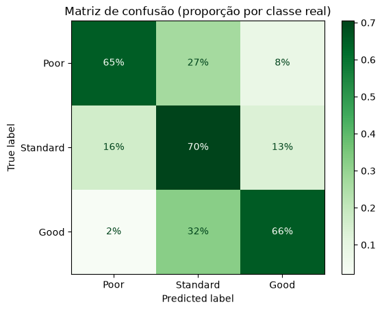
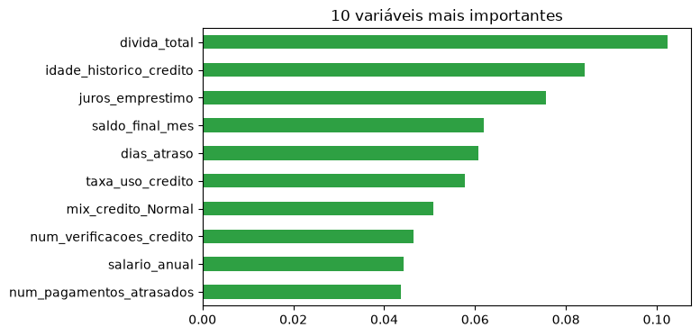

# Previsão de Score de Crédito


Classificação do score de crédito de clientes de um banco em **Good**,
**Standard** ou **Poor**, a partir do perfil financeiro (renda, dívidas,
atrasos, cartões, empréstimos). Base com 100 mil registros: 12.500 clientes
acompanhados por 8 meses.

## O achado principal: a divisão aleatória engana

Cada cliente aparece 8 vezes na base. Se treino e teste são sorteados por
linha, os meses de um mesmo cliente caem nos dois lados, e o modelo
"reconhece" o cliente em vez de aprender o padrão.

| Avaliação | Acurácia (Random Forest) |
| --- | --- |
| Divisão aleatória por linha | 81,1% |
| **Divisão por cliente** (`GroupShuffleSplit`) | **68,1%** |

A segunda é a que representa o uso real: prever o score de clientes que o
modelo nunca viu. Toda a comparação de modelos usa essa divisão.

## Resultados

| Modelo | Acurácia |
| --- | --- |
| **Random Forest** | **68,1%** |
| KNN (k=15) | 64,1% |
| Baseline (sempre "Standard") | 53,3% |

<p>
  
  
</p>

O erro mais caro para o banco, classificar como **Good** quem é **Poor**,
acontece em 8% dos clientes Poor.

## Decisões técnicas

- **Pipeline do scikit-learn:** `OneHotEncoder` nas colunas de texto e
  `StandardScaler` nas numéricas, ajustados **só no treino**. Na previsão de
  clientes novos o pipeline só aplica `transform`.
  - A primeira versão reajustava um `LabelEncoder` com `fit_transform` nos
    clientes novos, o que podia dar códigos diferentes dos do treino.
- **One-hot em vez de LabelEncoder**, para não criar uma ordem falsa entre
  profissões.
- `id_cliente` e `mes` ficam fora das variáveis do modelo.
- Semente fixa: os resultados são reproduzíveis.

## Rodando

```bash
pip install -r requirements.txt
jupyter notebook main.ipynb
```

## Próximos passos

- Validação cruzada por grupo (`GroupKFold`).
- Ajuste de hiperparâmetros.
- Pesos de classe para penalizar mais o erro Poor → Good.
